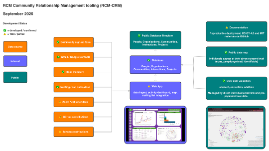

# RCM-CRM — Current Architecture Overview (Baserow)

This document describes the current, built architecture of the RCM-CRM: a Baserow-based system, not the original self-hosted SQL design (see `self-hosted-architecture/` for that alternative, still relevant for institutionally-hosted deployments).

## System overview

Editable source: `../../assets/images/source/data-process-overview_drawio.xml`.

## Components

### Database
Baserow tables: People, Organisations, Communities, Interactions, Projects. See `schema.md` for the full data model.

### Web App
Handles data ingest (per-source parsers), the internal dashboard, and mailing list integration. Access restricted to named accounts. **Not yet built.**

This is distinct from the **Kumu export pipeline** (`crm-kumu-visualisation` skill), which is already built and runs independently — see below. The Web App's planned "Kumu embed" would surface that pipeline's output inside a dashboard UI; the underlying export itself doesn't depend on the Web App existing.

<mark>Add image once tidied — Web App sub-map: parsers feeding into the Web App, branching to Dashboard/Kumu embed/export-prep. Editable source exists at `../../assets/images/source/data-process-web-app_drawio.xml`, but has no PNG export yet; style should match the Overview and Data model diagrams once updated.</mark>

### Kumu export (built, standalone)
The `crm-kumu-visualisation` skill (deterministic code, no LLM) converts the five Baserow exports into Kumu-ready `elements`/`connections` workbooks: an internal version (full data, real names) and a public version (consent-filtered via `mapping-consent` — people without active public consent are excluded entirely, pseudonymised people get a stable hashed label). See `schema.md` for the full field/edge/consent registry this pipeline implements, including two flagged open design questions.

### Self-serve
Consent, re-confirmation, correction, and addition — managed by a direct individual email link and pre-populated row data.

<mark>Add image once tidied — Self-serve sub-map: consent/identity intake form and email mailmerge re-confirmation loop feeding into a staging table, comparison script, staff review, and live record update. Editable source exists at `../../assets/images/source/data-process-self-serve_drawio.xml`, but has no PNG export yet; style should match the Overview and Data model diagrams once updated.</mark>

### Public data map
Individuals appear at their given consent level (none, pseudonymised, identifiable) — see the consent model in `data-privacy.md`.

## Development status

Legend: ✅ developed/confirmed · ⚠️ TBC/partial · ❌ not developed

<mark>Confirm whether a written development-status summary is needed here, duplicating the diagram's own legend, or whether the diagram alone is sufficient</mark>
