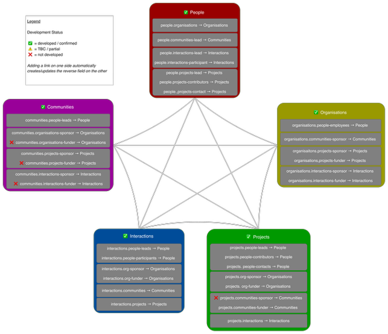

# Chapter 1: Designing the visualisation

## Table of contents

- [1. RCM Community Relationship Management tooling (RCM-CRM)](#1-rcm-community-relationship-management-tooling-rcm-crm)
- [2. Data Privacy](#2-data-privacy)
- [3. What you'd like to visualise in your data](#3-what-youd-like-to-visualise-in-your-data)
  - [3.1. Structuring your data](#31-structuring-your-data)

---
## 1. RCM Community Relationship Management tooling (RCM-CRM)

*Figure: overview of the RCM-CRM system — data sources feeding into the database, the web app built on top of it, and the outputs (dashboards, public data map, documentation) it supports.*

---

## 2. Data Privacy

Throughout your usage of the Baserow CRM and Kumu, you should be aware of whether your organisation will accept the holding of personally identifiable data on these cloud services.
We have reviewed the data privacy policies for both of these services and determined them to be appropriate for the use of data of this type.
However, you should undertake a Data Privacy (Impact) Assessment with your organisation before proceeding — see our [Data Privacy Assessment](../../data-privacy-assessment.md) for reference.
If you are uncertain, you can omit any identifiable data from Baserow and Kumu in order to prototype, and instead replace the names of people with a pseudonymised ID, retaining a link of which ID relates to which person via a key stored on your internally approved infrastructure.

---

## 3. What you'd like to visualise in your data

Before working with your data, you should be clear about what you want the data to be able to show, particularly where you want links to exist between different nodes — for example, linking "People" nodes to "Organisations" nodes where they are employees.
Consider also where you might like to see changes over time, for example new contributors to a project or growth in members of a community.
In short, what are the key questions you want to be able to answer in your data?
What data do you need to collect to validate any hypothesis about the impact of your community management?
This should reflect your application of your community strategy.

### 3.1. Structuring your data

Answering these questions will enable you to build a schematic like the image below.
Because a database is necessarily more rigid than a spreadsheet, it is valuable to decide these factors in advance.

1. **What are the nodes in your graph?** The RCM-CRM template ships with five tables: `People`, `Organisations`, `Communities`, `Interactions`, `Projects`. Decide whether all five are relevant to you, or whether some won't be used.
2. **What are the edges?** These represent relationships between nodes — for example, a person is linked to an organisation (where they are understood to be professionally engaged or otherwise affiliated with) or a project (where there is public record of their contribution to that project, for example, via GitHub).
3. **What is the scope of your data collection?** Determine what boundaries you will apply for data collection.
4. **Where might one real-world thing need two rows?** Some organisations are also communities (for example, a funder that also runs its own community). Decide in advance whether you'll create a linked pair of rows for these cases, rather than discovering it mid-import.

*Figure: the RCM-CRM data model — five tables (nodes) and the link fields (edges) connecting them. Adding a link on one side automatically creates/updates the reverse field on the other.*
