# Chapter 2: Entering data


## Table of contents

- [1. Create a Baserow account](#1-create-a-baserow-account)
- [2. Building your database structure](#2-building-your-database-structure)
  - [2.1. Download the rcm-crm template](#21-download-the-rcm-crm-template)
  - [2.2. Uploading into Baserow](#22-uploading-into-baserow)
- [3. Rename database](#3-rename-database)
- [4. Understanding field types](#4-understanding-field-types)
- [5. Review tables](#5-review-tables)
- [6. For each table](#6-for-each-table)
  - [6.1. Review sorting and filtering options](#61-review-sorting-and-filtering-options)
  - [6.2. Review fields](#62-review-fields)
    - [6.2.1. Fields we suggest keeping](#621-fields-we-suggest-keeping)
  - [6.3. Review primary field](#63-review-primary-field)
  - [6.4. Reordering fields](#64-reordering-fields)
  - [6.5. Freezing fields](#65-freezing-fields)
  - [6.6. Amend fields](#66-amend-fields)
- [7. Add data rows](#7-add-data-rows)
  - [7.1. Note on adding parents first](#71-note-on-adding-parents-first)
  - [7.2. Add via grid view](#72-add-via-grid-view)
  - [7.3. Add data by enlarged row](#73-add-data-by-enlarged-row)
- [8. Dealing with duplicates](#8-dealing-with-duplicates)
  - [8.1. Current working practice](#81-current-working-practice)
  - [8.2. Key lessons from the automation attempt](#82-key-lessons-from-the-automation-attempt)
- [9. Advanced usage: API calls](#9-advanced-usage-api-calls)
  - [9.1. Getting access: database tokens](#91-getting-access-database-tokens)
  - [9.2. Getting the current table structure (field definitions)](#92-getting-the-current-table-structure-field-definitions)
  - [9.3. What we've deliberately not used the API for](#93-what-weve-deliberately-not-used-the-api-for)
  - [9.4. A note on infrastructure](#94-a-note-on-infrastructure)

---

## 1. Create a Baserow account

Before you can build your database, you'll need an account on [baserow.io](https://baserow.io). Baserow offers a free Cloud plan, which is sufficient for this template. See the **Baserow docs:** [Quick start guide — Step 1: Your account and first workspace](https://baserow.io/user-docs/how-to-get-started-with-baserow) page for account creation instructions.

---

## 2. Building your database structure

### 2.1. Download the rcm-crm template

The [rcm-crm structure-only export](../../../assets/baserow-structure/baserow-structure-rcm-crm.zip) is included in this repo for you to reuse.

You have two ways to copy the file for your reuse:

- **Clone the whole repo** — recommended, since this also gives you the accompanying code (skills, pipelines) that work alongside the CRM, not just the database structure. See GitHub's own documentation: [Cloning a repository](https://docs.github.com/en/repositories/creating-and-managing-repositories/cloning-a-repository).
- **Download just the .zip** — if you only want the database template, use the direct download link on this page: the [rcm-crm structure-only export](../../../assets/baserow-structure/baserow-structure-rcm-crm.zip). See GitHub's own documentation: [Downloading source code archives](https://docs.github.com/en/repositories/working-with-files/using-files/downloading-source-code-archives).

Whichever route you use, upload the `.zip` file **as-is — do not unzip it first**. Baserow expects the `.zip` itself, not its extracted contents.

### 2.2. Uploading into Baserow

1.  Log into Baserow and go to your `Home` page — this can be found in the left-hand navigation bar from any view in Baserow.
2.  Click on the large heading `<your name>'s workspace`. This will open a dropdown list of options — click `Import data`.
3.  Upload the `.zip` file from [above](#21-download-the-rcm-crm-template) — do not unzip it first. Baserow expects the `.zip` itself, not its extracted contents.

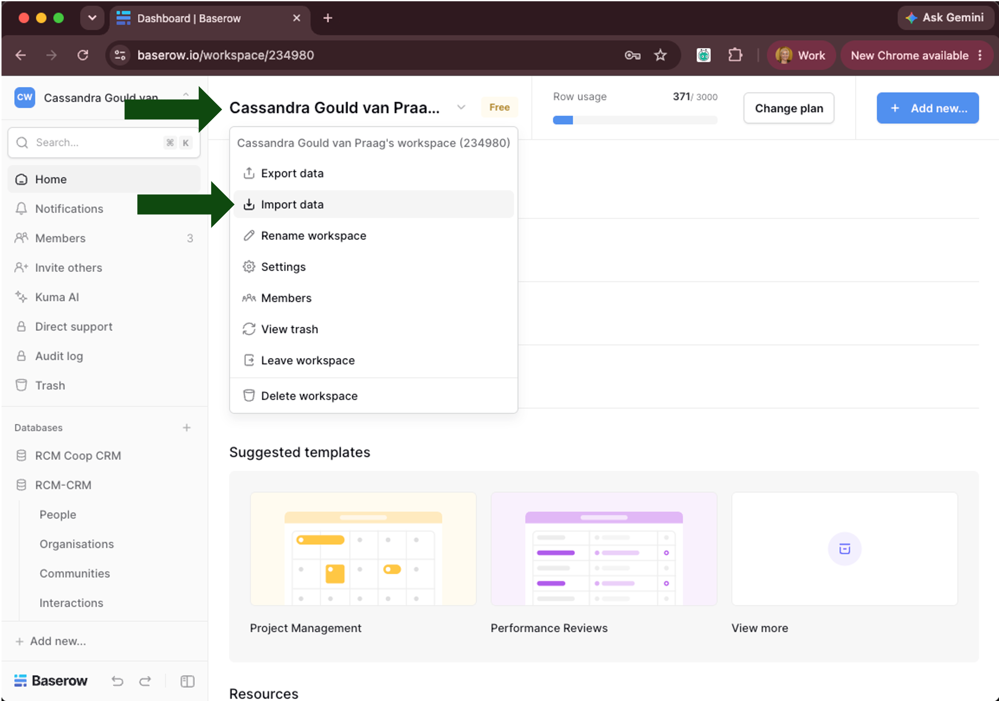

*Figure: the Baserow homepage showing the sidebar/workspace name, and the opened dropdown with Import data highlighted.*

Once imported, you'll have a full copy of the RCM-CRM database structure in your own workspace.

---

## 3. Rename database

From the `Home` screen, find the imported `rcm-crm` database. Click on the three dots on the far right of the database name. Click `Rename`. We suggest renaming this to `<your community name> CRM`.

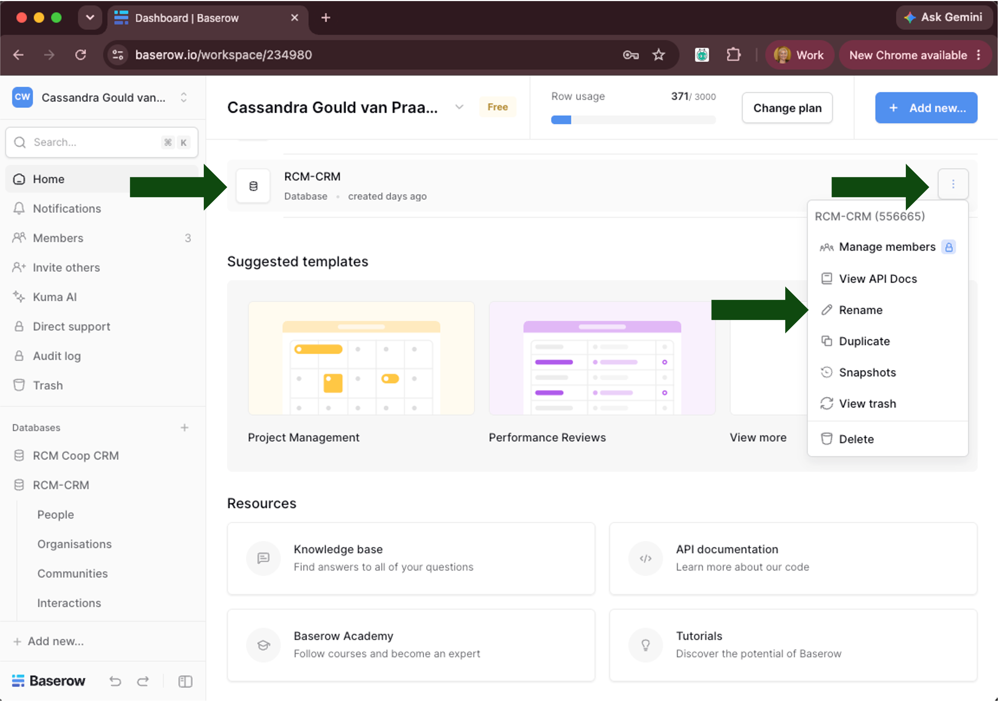

---

## 4. Understanding field types

Before reviewing or amending any fields, it's worth understanding the field types Baserow offers. Each field type enforces its own data validation and formatting, and unlocks type-specific features such as filtering, sorting, and cross-table relationships. Take a look through the available types before deciding whether to keep, delete, or add fields in the next steps.

Some examples of field types used in this template:

- **Text** — free-text entry, for example, notes fields.
- **Number** — numeric values, for example, a count or year.
- **Formula** — a computed value calculated automatically from other fields, for example, a name field built from first name + last name.
- **Single select** — one choice from a fixed list, for example, `project-status` (Pre-submission, Submitted, Active, Completed, Rejected).
- **Multiple select** — one or more choices from a fixed list, for example, tagging a row with more than one category at once.

See the **Baserow docs:** [Fields overview](https://baserow.io/user-docs/baserow-field-overview) page for the full list of field types and guidance on choosing between them.

---

## 5. Review tables

Your available databases will be shown in a list on the left of the screen.

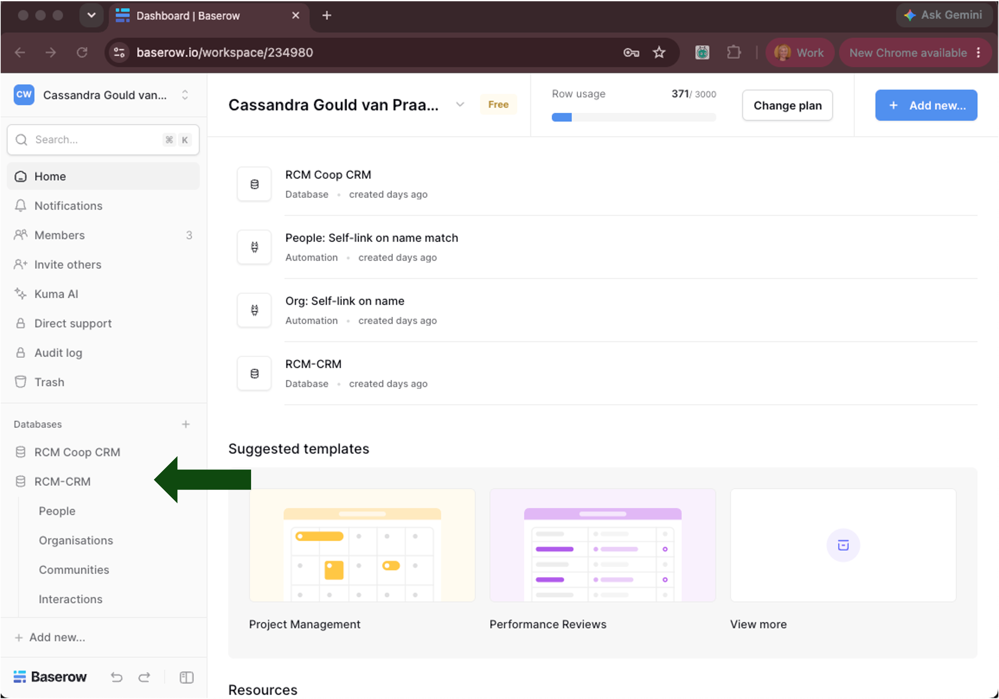

Under the database name is a list of individual tables within that database. The rcm-crm template is pre-populated with separate tables for `People`, `Organisations`, `Communities`, `Interactions` and `Projects`. These are the nodes shown in [Structuring your data](01-designing-the-visualisation.md#31-structuring-your-data).

---

## 6. For each table

In Baserow, a **field** is the database equivalent of a column in a spreadsheet. We'll use "field" throughout this documentation, since it's the term Baserow's own interface and documentation use — but if you're more familiar with spreadsheets than databases, read "field" as "column".

Work through each of the tables in turn, and repeat the following steps for each.

### 6.1. Review sorting and filtering options

Baserow lets you sort and filter each view without changing the underlying data — filtered-out rows are just hidden, never deleted.

See the **Baserow docs:** [Filters in Baserow](https://baserow.io/user-docs/filters-in-baserow) page for more on filtering, and the **Baserow docs:** [Field customisation](https://baserow.io/user-docs/field-customization) page for sorting and grouping.

**Note:** check whether the imported template already has a sort or filter applied to a table's default view — if so, decide whether to keep it or clear it before you start entering your own data. It may be helpful to turn off all sorting first, so you can see your data in its raw, unsorted state before deciding how you'd like it organised.

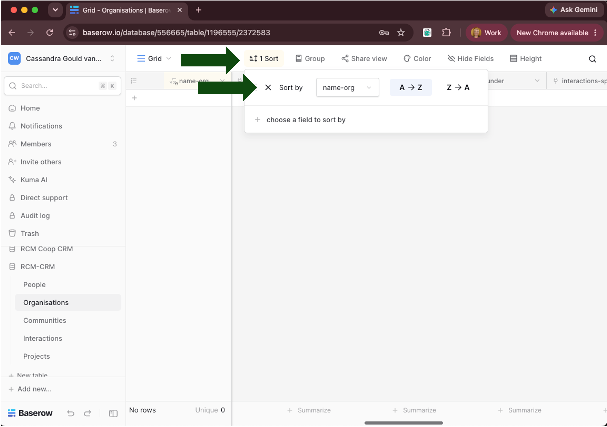

### 6.2. Review fields

Go through the table's fields and check whether each one is relevant for your needs. Delete anything you don't need — you can always add it back later if it turns out to matter.

- To delete a field: click the dropdown arrow on the field header, then select `Delete field`.

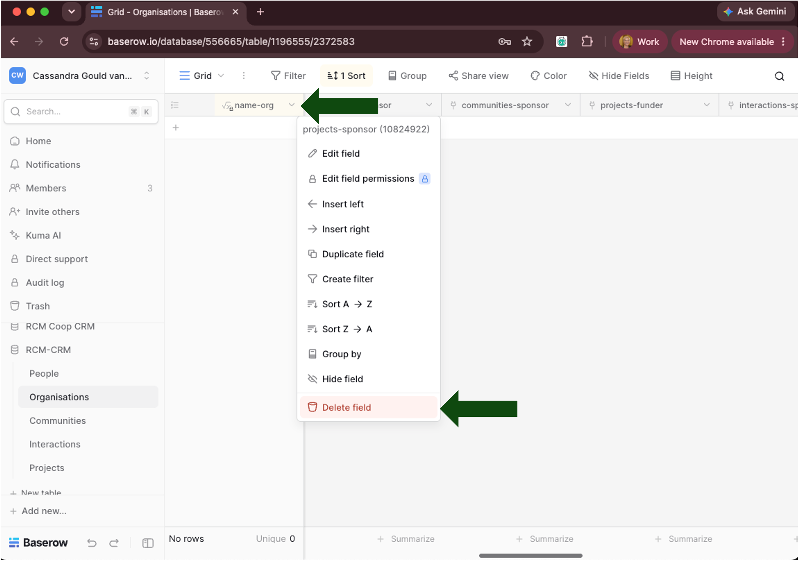

Other actions for a field are also available via this same dropdown next to the field name (for example, editing the field type, duplicating, hiding). See the **Baserow docs:** [Field customisation](https://baserow.io/user-docs/field-customization) page for the full set of options.

**Row IDs:** every row is automatically assigned a permanent, unique ID number when it's created. This number increases as rows are added, and is never reassigned — if you delete a row, the deleted row ID won't appear in the list again for a new row. <mark>Unchecked whether deleted rows count towards the total allowed allocation for free accounts.</mark> See the **Baserow docs:** [Overview of rows](https://baserow.io/user-docs/overview-of-rows) page for more detail.

**A note on field order:** if you plan to use the `crm-notes-extraction` or `crm-email-contacts` skills, be aware that reordering fields in the live tables may break their column alignment, since these workflows rely on manual copy-paste from a prepared spreadsheet, using screenshots to align columns — Baserow doesn't preserve true on-screen field order via its API or plain export. If you do reorder fields, the skill's screenshots and/or code will need to be updated to match the new order. Field order does not matter for the Kumu export, or for entering data directly into Baserow's UI.

**A note on field naming:** if you plan to use the `crm-notes-extraction`, `crm-email-contacts`, or `crm-kumu-visualisation` skills, be aware that renaming fields in the live tables will require the corresponding skill code to be updated to match, since all three reference exact field names. If you're entering data directly into Baserow's UI without using these skills, field naming is entirely up to you.

#### 6.2.1. Fields we suggest keeping

- `Created on` \[date\]
- `Created by`
- `Last modified` \[date\]
- `Last modified by`

These are useful for sorting rows chronologically and for seeing who has added or updated data. See the **Baserow docs:** [Date and time fields](https://baserow.io/user-docs/date-and-time-fields) page, the **Baserow docs:** [Last modified field](https://baserow.io/user-docs/last-modified-field) page, and the **Baserow docs:** [Created by field](https://baserow.io/user-docs/created-by-field) page for more detail. If a row is edited by a guest — someone submitting via a form without being signed into Baserow (see [Enabling self-serve editing](04-enabling-self-serve-editing.md)) — the `Last modified by` field will be blank, since there's no signed-in collaborator to attribute the change to.

- `Edit row URL`

This holds the shareable link that lets someone self-serve edit their own row without needing a Baserow account — see [Enabling self-serve editing](04-enabling-self-serve-editing.md) in Chapter 4 for what this field is for and how it's used.

- `-user-nominated` fields on the `People` table, unless you are not intending to collect any data about those fields (for example, you are not interested in GitHub alternative usernames).

These fields capture information a person enters about themselves via the self-serve/sign-up form — the `-user-nominated` suffix distinguishes them from fields you'd populate yourself. See [Enabling self-serve editing](04-enabling-self-serve-editing.md) in Chapter 4 for the full list of these fields and what's expected in each.

### 6.3. Review primary field

Every Baserow table has a **primary field** — always the first field, which cannot be deleted, moved, or hidden. It acts as each row's unique identifier, and its value is what's shown when that row appears as a linked reference elsewhere (for example, the title card shown when you link this row from another table). You can change its type, but not swap in a different existing field as primary.

Check that each table's primary field is set to something meaningful and unique for your data (for example, a computed full-name field), since it's what you'll see everywhere this row is referenced across the database.

See the **Baserow docs:** [Primary field](https://baserow.io/user-docs/primary-field) page for more detail.

### 6.4. Reordering fields

Click and drag a field's name to move it to where you want it in the table. See the note on field order under [Review fields](#62-review-fields) if you're using the `crm-notes-extraction` or `crm-email-contacts` skills — reordering will break their column alignment.

### 6.5. Freezing fields

**Field names are automatically frozen vertically** — they stay visible at the top of the table as you scroll up and down.

**Freezing fields horizontally:** by default, only the primary field (the first column) is frozen so it stays visible as you scroll left and right. To change which fields are frozen, drag the vertical divider line to the right of the field you want to freeze — everything to its left stays fixed in place while you scroll.

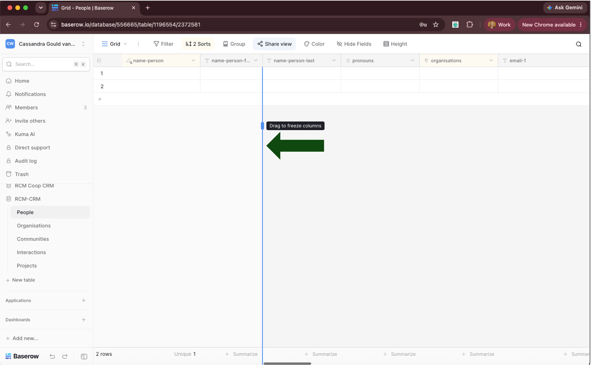

### 6.6. Amend fields

If your data model (see [Structuring your data](01-designing-the-visualisation.md#31-structuring-your-data)) calls for fields the template doesn't have, you'll need to add them.

See the **Baserow docs:** [Fields overview](https://baserow.io/user-docs/baserow-field-overview) page for a general guide to adding fields and choosing the right field type. If you need a computed/formula field (for example, auto-generating a display name from other fields, as several tables in this template do), see the **Baserow docs:** [Formula field overview](https://baserow.io/user-docs/formula-field-overview) page.

---

## 7. Add data rows

### 7.1. Note on adding parents first

In practice, it's easier to enter all of a table's rows before creating anything that links to them. For example, create rows for each organisation in the `Organisations` table before creating people who are linked to that organisation. This way, when you reach the linking step, the row you need to link to already exists and you're not switching back and forth between tables mid-entry.

### 7.2. Add via grid view

Some users will already have prepared a full or partial list of rows to include in their CRM, likely in a spreadsheet format. In these cases, it is easier to add data by copying and pasting from an existing spreadsheet directly into Baserow. You can paste data directly into Baserow in the Grid view.

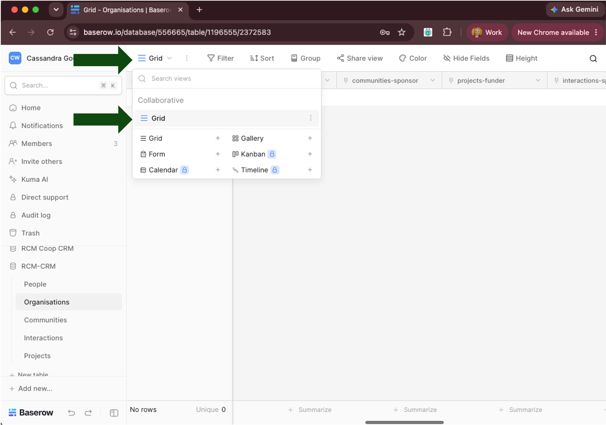

You can paste a whole row at once — one spreadsheet row with multiple columns can be pasted into one Baserow row across multiple fields in a single paste. Be mindful of field order when doing this: the pasted columns fill fields left-to-right starting from wherever you click, so your spreadsheet's column order needs to match the Baserow table's field order for the data to land in the right fields. If you need to change your field order first, see [Reordering fields](#64-reordering-fields).

Make sure the data you're pasting matches the target field's type — for example, plain text from a spreadsheet should go into a text field in Baserow. <mark>We've not tested what happens if you try to paste a value into a mismatched field type, for example, a string into a number field.</mark>

> **Tip: bulk-linking records**
>
> A `Link to table` field lets one row reference one or more rows in another table — for example, an Interaction row linking to every Person who took part. When a link field allows multiple entries, clicking into its cell opens a **row-select modal**: a searchable list of the linked table's existing rows, where you tick or select the ones you want to connect. For a handful of links this is straightforward, but it can get slow if you're linking many rows at once (for example, adding twenty attendees to one Interaction) — the two approaches below speed that up.
>
> - **Keyboard-only, one at a time:** in the row-select modal, select a row via arrow keys + Enter, then press Escape to return to the table with that row added. Pressing Enter again reopens the select modal for the next linked item — the whole add-multiple-links flow can be done without touching the mouse.
> - **Bulk paste, many at once:** copy a single comma-separated string of full canonical names (matching the linked table's primary field format) from one Excel cell, then paste directly into the target link-field cell to bulk-link matching *existing* records — no need to touch the mouse or rewrite the table. (A prep tool to auto-format attendee lists into this comma-separated form is planned for the future webapp.)
>
> Both approaches only link to rows that **already exist** in the target table — this is why [adding parent rows first](#71-note-on-adding-parents-first) matters. If a name doesn't already exist as a row, it won't appear as a match and won't get linked.

### 7.3. Add data by enlarged row

Click the small enlarge icon on the left side of a row to open it in the **enlarged row view** (also accessible by right-clicking the row).

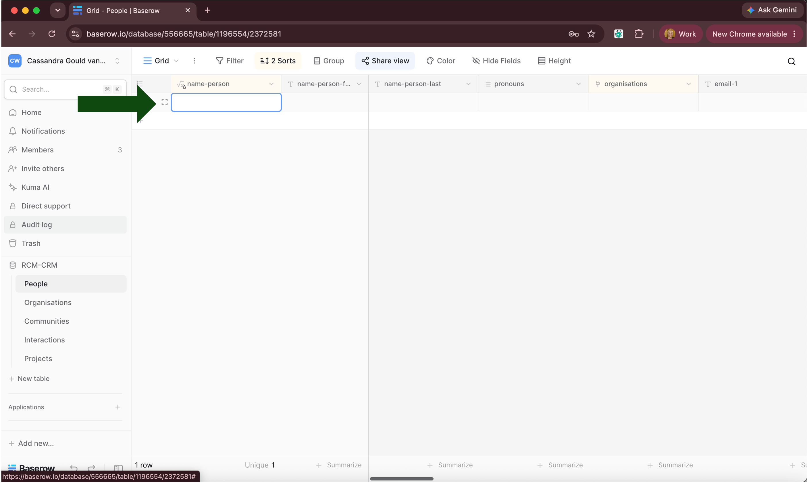

This shows every field for that row, stacked vertically, all editable in one place — no separate form-building step, and no public share link involved. It respects the table's hidden fields (a hidden field stays hidden here too).

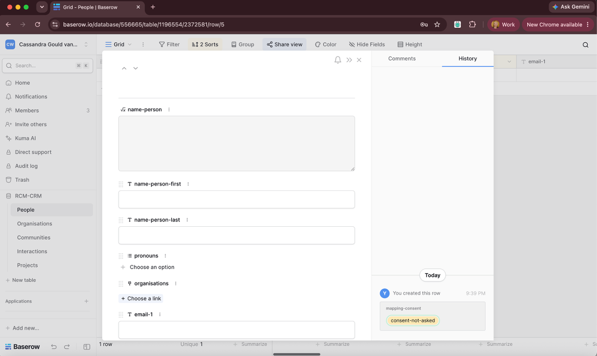

This is a good option for adding or editing a single row in detail, but less suited to bulk adding many rows at once — for that, use [Add via grid view](#72-add-via-grid-view).

See the **Baserow docs:** [Enlarging rows](https://baserow.io/user-docs/enlarging-rows) page for more detail.

---

## 8. Dealing with duplicates

It is possible and likely that data for the same row (person, organisation, and so on) may be accidentally added twice, for example when data are being imported from mailing lists or event participant exports. This section covers how to catch and clean up those duplicates.

Baserow can automatically stop a duplicate row from being created, by setting a **unique value constraint** on a field — this simply means Baserow will refuse to save a new row if that field's value already exists elsewhere in the table. This automatic duplicate detection, however, is not well suited for the type of data you are likely to be working with in a CRM. For example:

- **Names alone aren't unique enough to enforce.** Two genuinely different people can share the same name (for example, two "James Smith"s in different organisations), so we can't set a unique constraint on the name field without risking a real, distinct person being blocked from being added.
- **Email alone can miss duplicates too.** If we tried constraining on email instead, we'd still miss cases where the *same* person has been entered twice using two different email addresses (for example, a work address on one row, a personal address on the other) — since each row's `email-1` field would hold a different value, Baserow would see no conflict and let both through.

Baserow does have a documented workaround for this: a **compound field** — a Formula field that concatenates two or more fields together (for example, name + email) — with the unique constraint applied to that combined value instead of either field alone. This narrows the false-positive risk (two different "James Smith"s with different emails would no longer collide), but doesn't solve the second problem above, since a genuine duplicate entered with a different email still produces a different combined value.

**A note on an earlier attempt:** we tried building a softer, non-blocking "self-link on name match" automation — a self-referencing link field plus a count field that would flag possible duplicate names without blocking row creation. The specific difficulty was with the trigger: we could get it working on **row update** (for example, when a new email is added to an existing row), but the same automation would also need to run on **new row creation** for the duplicate check to be reliable — and we couldn't get both triggers working consistently together. This wasn't consistently effective in practice, so it's not documented here as a working approach. <mark>Marked for future development — revisit if a reliable non-blocking duplicate flag is needed.</mark>

### 8.1. Current working practice

Duplicates are currently managed manually. This is not a fail-safe method, but it is effective if close attention is paid to the data.

1.  After entering new data, sort the table alphabetically by name (see [Review sorting and filtering options](#61-review-sorting-and-filtering-options)).
2.  Look through the sorted list for duplicate rows.
3.  If a duplicate is found, update the **original** row (the one with the lower row ID — see [Row IDs](#62-review-fields)) with any new information the duplicate row was going to add, for example, a new interaction linkage.
4.  Rename the duplicate row using an obvious identifier, for example prefixing its name with `**DELETE**` (for example, `**DELETE**Jane Smith`).
5.  Re-sort the table alphabetically. The `**DELETE**`-prefixed rows will now sort to the top of the list, making them easy to find and delete in a batch.

### 8.2. Key lessons from the automation attempt

In case this is picked up again for another table, here's what we learned trying to get the self-link duplicate-check automation working:

- `Id` cannot be used as a **filter** field in Read-a-row/List-rows conditions (not in the filterable-types list) — it can only be used as a **value** inside a Router/formula comparison.
- A trigger's `[All]` represents the full batch array even for a single created/updated row — use numeric index `0` to get a plain scalar instead. This resolves a "value must be an integer" error that otherwise persists across several formula attempts.
- On a "Read a row" step specifically, a Row ID reference needs a `concat(ref, "")` wrapper to satisfy Baserow's type checking — `join()` throws an error on non-string list items ("expected str instance, int found"), but `concat()` auto-coerces types when joining. An "Update a row" step's Row ID does not need this wrapper.
- `to_text()` does not exist as a Baserow function (confirmed via the Functions-tab search) — `to_datetime`, `to_duration`, `to_array`, `to_json` do.
- A Count field pointed at a self-referencing link field is a **native Count field type**, not a formula.
- The Draft "Stop test run" control reverts to "Start test run" once a real matching event has occurred — it is not a persistent listening session. The reliable test flow is: create/update the row first, then use each node's own "Test node" button, and check the automation's **History** tab for pass/fail per run, rather than relying on the visual canvas.
- Free tier automation credits are capped at 2,000/workspace/month, and each test run observed consumed 2 credits — worth watching if this is rebuilt and run live, since usage scales with row-creation/update volume table-wide.

---

## 9. Advanced usage: API calls

Everything so far in this chapter covers using Baserow through a web interface — clicking, typing, and pasting directly into tables. Baserow also offers an **API** (Application Programming Interface), which lets a piece of code talk to your Baserow database directly, instead of a person clicking through the interface. In practice, this means you can write a script that reads data out of Baserow, or writes data into it, automatically.

This section covers what we've found the API useful for so far, what we've deliberately chosen not to use it for, and the privacy and infrastructure considerations that shaped those decisions.

### 9.1. Getting access: database tokens

To make any API call, you first need a **database token** — a long string of characters that acts like a password, proving to Baserow that a request is allowed to access your data. Tokens are created per workspace, and can be scoped down to specific databases or tables, with separate permissions for create, read, update, and delete.

See the **Baserow docs:** [Database tokens](https://baserow.io/user-docs/personal-api-tokens) page for how to create one, and the **Baserow docs:** [Database API documentation](https://baserow.io/user-docs/database-api) page for the full list of available API calls.

**Privacy note:** a token grants whatever access you assign it, to whoever holds it. Treat it like a password — never commit it to a public repository, and revoke it as soon as you're done with it if it was only needed for a one-off task.

### 9.2. Getting the current table structure (field definitions)

#### Why this is necessary

A plain data export (like the `Export table` button, or a row-data export) only gives you the *current values* in each row — it doesn't tell you:

- What each field's **type** actually is (link-to-table vs. plain text vs. formula vs. single-select);
- Which table a **link field** actually points to;
- The full list of **options** for a single-select/multiple-select field;
- The **formula text** behind a computed field (for example, how `name-project` is derived).

Row data alone can't tell the difference between a plain text field that happens to contain a name, and a genuine link-to-table field — the structure export is the only reliable way to know with certainty, and the only reliable way to catch schema drift over time as fields get renamed, added, or retyped.

#### How to do it

1.  **Generate a token**

    - In Baserow, go to account → **API tokens** settings.
    - Create a new token, scoped to **read-only**, and scoped to just the specific database (not workspace-wide) if that option is available.
    - Name it descriptively — purpose + scope + date, for example `schema-export-readonly-20260924`.

    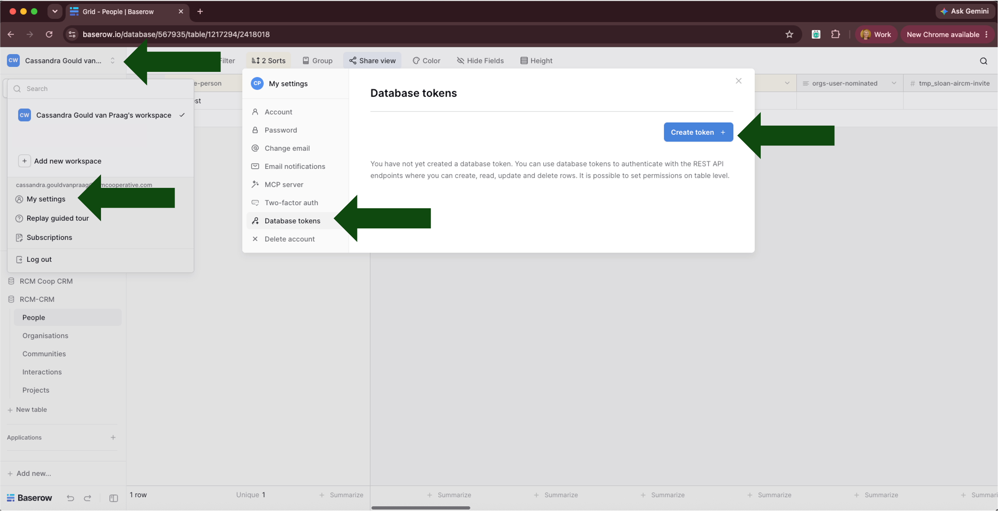

    - Set the required permission level, then copy the generated token (a random string) — this is shown only once, so copy it now.

    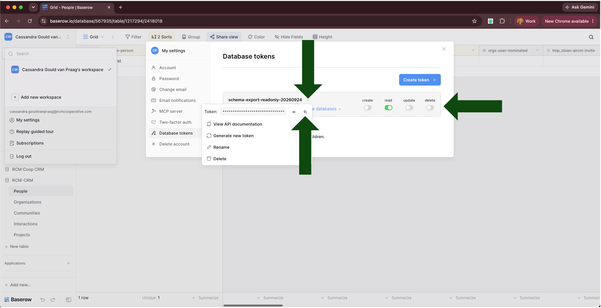

2.  **Call the field-definitions endpoint, once per table**

    Run this from your project's root directory, so the relative output path below resolves correctly.

    ``` bash
    EXPORT_DIR="assets/baserow-structure/structure-exports/$(date +%F)"
    mkdir -p "$EXPORT_DIR"

    curl -H "Authorization: Token YOUR_TOKEN_HERE" \
      https://api.baserow.io/api/database/fields/table/{table_id}/ \
      | python3 -m json.tool > "$EXPORT_DIR/baserow-structure-json-<TableName>.json"
    ```

    `mkdir -p` creates today's dated folder if it doesn't already exist, and does nothing (no error) if it does. Run the two setup lines (`EXPORT_DIR=...` and `mkdir -p`) once, then repeat just the `curl` line five times — once per table — reusing the same `$EXPORT_DIR` each time, as long as you stay in the same terminal session. Replace `YOUR_TOKEN_HERE` with your token, `{table_id}` with each table's numeric ID, and `<TableName>` with the matching output filename — five calls total, one per table (`People`, `Organisations`, `Communities`, `Interactions`, `Projects`). Keep to this `baserow-structure-json-<Table>.json` naming pattern, so structure exports and row-data exports are easy to tell apart by name alone.

    **Getting the table ID right:** a Baserow table URL looks like `.../table/{table_id}/{view_id}` — use only the `table_id` segment (the first number after `/table/`), not the view ID that follows it. Including the view ID produces a `URL_NOT_FOUND` error.

    (**JSON** — the format each response comes back in — is a plain-text format for structured data, widely used by APIs; it stores information as labelled pairs, for example `"field_name": "email-1"`, in a way that's straightforward for other software to read.)

3.  **Sanitise before storing or sharing the export**

    - Strip the `available_collaborators` array from any `"Last modified by"`/`"Created by"` field — this contains real workspace member names, not just a reference ID. Open the file in a text editor (for example VS Code) and search for your own name — as an administrator, you should appear as one of the available collaborators, which will take you straight to an `available_collaborators` array. Each entry in the array holds an `"id": <id-number>` and `"name": <user-name>` pair, for every collaborator with access. Delete everything *inside* the square brackets, leaving an empty array (`[]`) in its place, and repeat for every `available_collaborators` array in the file — one per `"Last modified by"`/`"Created by"` field.

      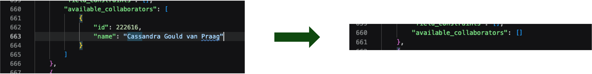

    - Confirm no field's `description` is populated with anything sensitive — search the file for `"description":` followed by anything other than `null`.

4.  **Revoke the token immediately after use**

    - Delete it from API tokens settings.
    - Treat it as single-use — generate fresh each time, rather than keeping a standing token around.

    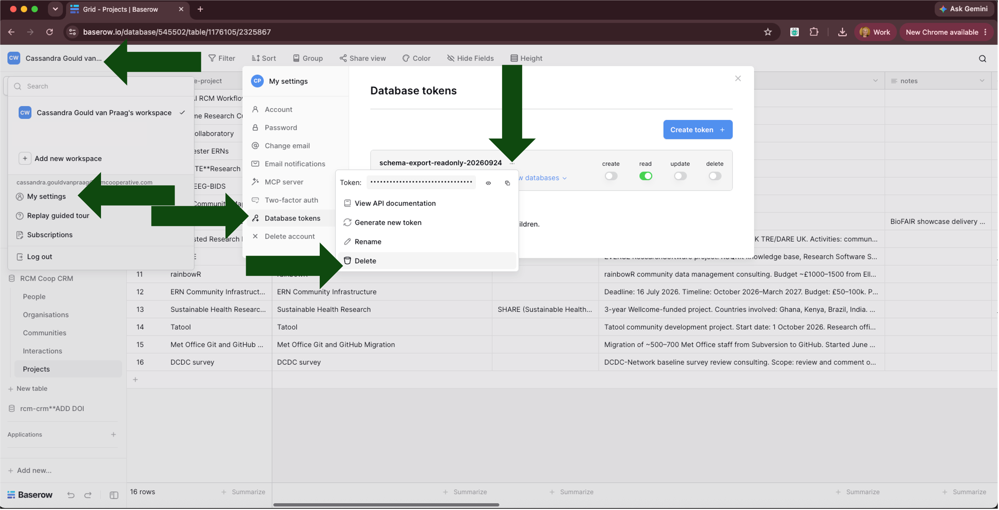

#### When to re-run this

- Whenever the schema changes (a field renamed, added, or retyped) — anything relying on the structure otherwise goes stale.
- Before a significant debugging session, so you're working against the *current* live structure, not a remembered one from an earlier session.

This is the process behind the dated snapshots in `assets/baserow-structure/structure-exports/YYYY-MM-DD/` — a new dated folder each time the structure is re-extracted, holding one `.json` (and, where produced, one column-order `.csv`) per table.

### 9.3. What we've deliberately not used the API for

**Writing data into Baserow automatically.** We've kept all data entry manual (copy-paste, or typed directly into the interface — see [Add data rows](#7-add-data-rows)) rather than having a script write to Baserow via the API. The reason is privacy: some of the tools that could prepare data for a bulk API write (for example, matching a spreadsheet of contacts against existing `People` rows) would otherwise need to pass CRM data through an AI model's reasoning process to do the matching — and we wanted to avoid exposing personal data to an AI model at all. The scripts we do use (see the `crm-notes-extraction` and `crm-email-contacts` skills) are written to do this matching with plain code instead, with no AI model involved, but even so, we've chosen to keep the final write step manual for now, so a person always reviews what's being added before it lands in the live database.

**Baserow's import/upsert feature.** Baserow's own bulk-import tool can match incoming data to your column headers by name, and has an "update rows if they already exist" mode, matched against a field you choose as the unique key. This would solve part of the duplicate problem described in [Dealing with duplicates](#8-dealing-with-duplicates), but we haven't used it yet — the data our extraction skills produce doesn't reliably include a matching key (for example, an email address) for every row, since that information isn't always present in the source material (like meeting notes). This is worth revisiting once more of your `People` records have verified emails.

### 9.4. A note on infrastructure

None of the above requires anything beyond a Baserow account and a token — the scripts we use run locally, on an individual's own laptop. If usage grows to the point of needing automatic API writes at scale, our plan (not yet built) is for that to run on infrastructure the organisation controls directly, rather than a script running from someone's personal laptop, so that CRM data isn't copied out to individual devices unnecessarily.

<mark>This section reflects current practice as of this documentation. Revisit if the API-writing stance above changes.</mark>
