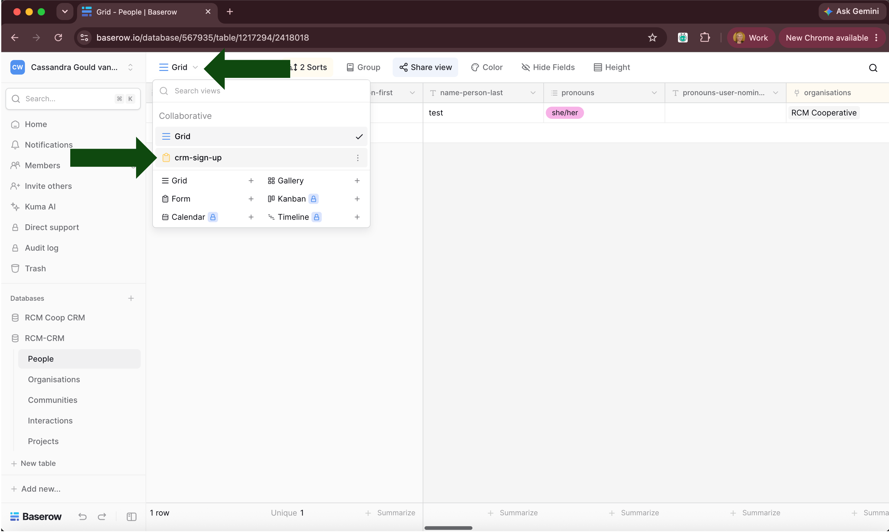
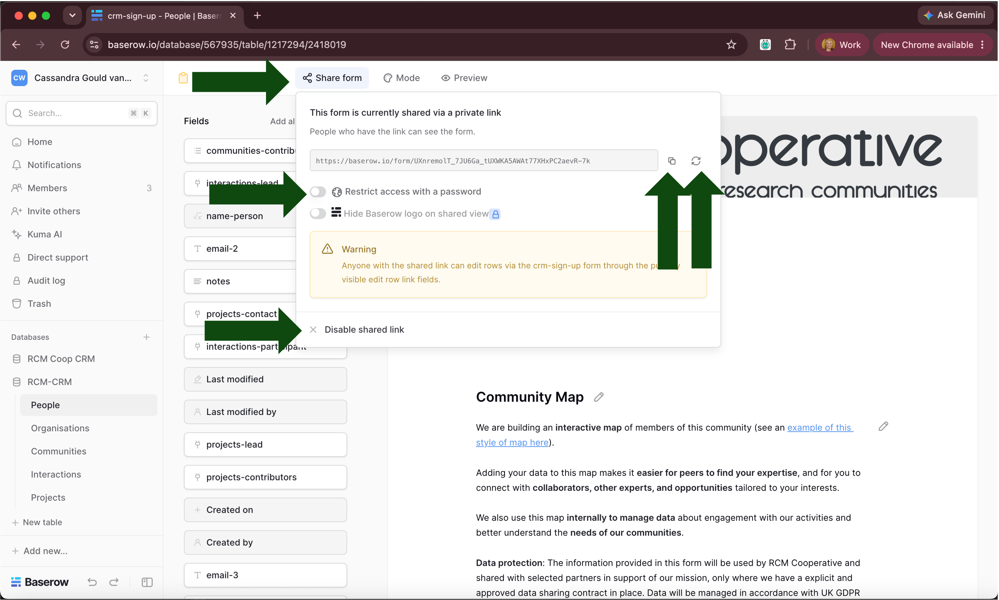
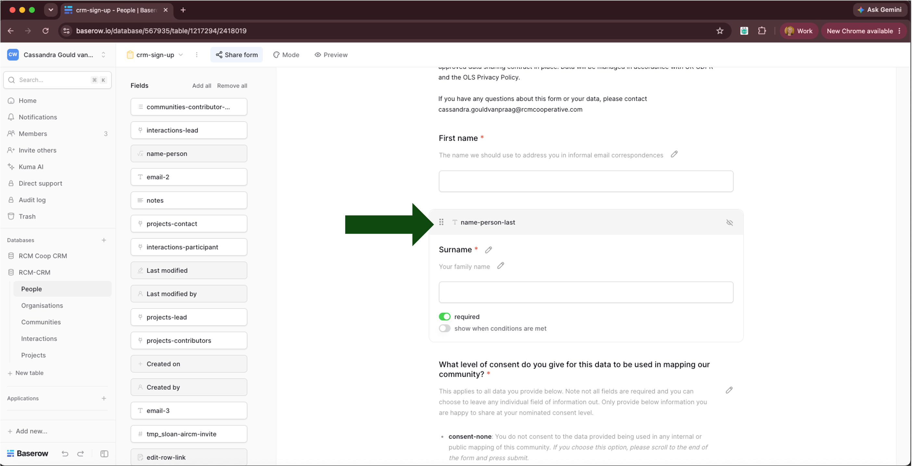
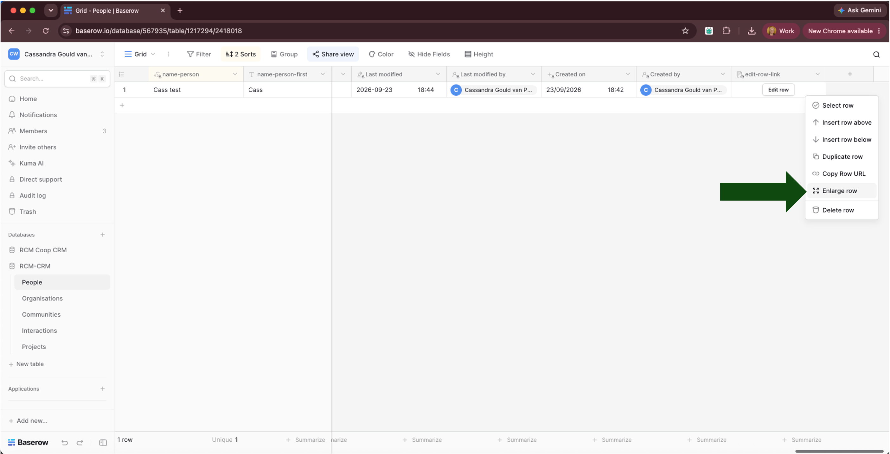
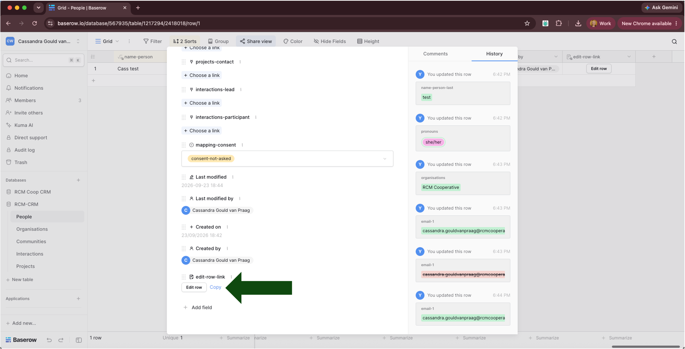
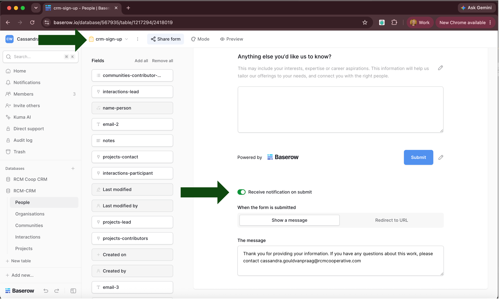
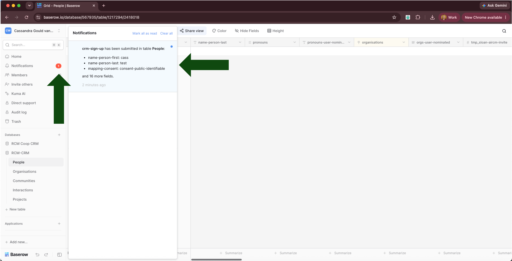

# Chapter 4: Enabling self-serve editing

## Table of contents

- [1. Enabling users to add or edit their own data (self-serve)](#1-enabling-users-to-add-or-edit-their-own-data-self-serve)
  - [1.1. Why enable self-serve](#11-why-enable-self-serve)
  - [1.2. Adding new rows via the form](#12-adding-new-rows-via-the-form)
    - [1.2.1. How to add new data into linked fields](#121-how-to-add-new-data-into-linked-fields)
    - [1.2.2. Form design considerations](#122-form-design-considerations)
  - [1.3. Editing existing rows via the form](#13-editing-existing-rows-via-the-form)
    - [1.3.1. Administrators link](#131-administrators-link)
    - [1.3.2. Users link](#132-users-link)
- [2. Tracking and being notified of additions and edits](#2-tracking-and-being-notified-of-additions-and-edits)
  - [2.1. Addition of a new row via self-serve](#21-addition-of-a-new-row-via-self-serve)
  - [2.2. Edit of a row via self-serve](#22-edit-of-a-row-via-self-serve)

---

## 1. Enabling users to add or edit their own data (self-serve)

### 1.1. Why enable self-serve

Handing editing control over to your community members directly is a valuable feature of Baserow. Rather than you collecting and entering all information secondhand, individuals can maintain their own record — correcting mistakes, adding detail, and keeping their information current. This makes them active participants in growing and sharing knowledge about their communities, rather than passive subjects of your data collection.

Self-serve is enabled by sharing a form with users. This form is built from the fields in your table (the field must exist in your table before it can be used in a form), and you can choose what fields it contains. You can build multiple forms per table, and each form can be distributed via a separate URL. See the **Baserow docs:** [Guide to creating forms in Baserow](https://baserow.io/user-docs/guide-to-creating-forms-in-baserow) page for more detail.

The rcm-crm template ships with a form named `crm-sign-up` in the `People` table, which can be used to add new rows to the `People` table. The shipped form will add data to your templated `People` table, and not back into our original.

The same form structure is used to present data to users for editing or validation (see [Editing existing rows via the form](#13-editing-existing-rows-via-the-form) below). You're welcome to edit this form for your needs. <mark>We need to add this repo doi and license to the form.</mark> Switch from Grid view to this Form view using the view switcher on the left of the table. If you change the fields on your `People` table from the imported template structure, remember the form itself will need to be updated to match — it doesn't update automatically.

This form can be pre-poulated with data from an indivdual row, for users to review and update. A pre-populated form is more useful than sending everyone a blank form to complete from scratch: it saves the user time since they only need to review and amend rather than retype what's already known, and a prepared dropdown list (for example, `Organisations`) guides them toward existing records rather than relying on free text — improving data accuracy as well as speed.

See [`platform-needs-assessment.md`](../../platform-needs-assessment.md), Table 4, for further discussion around the design decisions around self-serve.

Note that the submission of data via a public form may result in duplicates. See Chapter 2's [Dealing with duplicates](02-entering-data.md#8-dealing-with-duplicates) section for guidance on how to manually resolve duplicates.

### 1.2. Adding new rows via the form

Here we will refer to the shipped `crm-sign-up` form in the `People` table, as this one (or your own customisation of it) is well suited for individual data collection. The same process can be used for any form you create for any table.

A form can be shared two ways: (1) as a blank form, for anyone to sign up fresh, or (2) pre-populated with an existing row's data via the `edit row` url. Both options use the same underlying form, so the wording, field descriptions and logic only need to be built once.

To share the blank form for public sign-up, copy the form url by clicking the `Share` button in form view. You can copy the link to clipboard by pressing the `copy` icon at the end of the form url. You can also generate a new url, disable a url, and password protect a url from the same options screen.

**Generate new URL**: Creates a fresh public link and automatically expires the old one. Anyone who still has the previous URL loses access; only the new URL works. This is useful when you want to revoke access for a specific set of people (for example, after distributing to one cohort) while keeping the form itself live and accepting new submissions going forward.

**Disable shared link**: Turns public access off entirely. The form stops accepting any submissions at all and but the underlying share settings (like a set password) are cleared, so there's nothing to simply "turn back on" — reopening it later requires reconfiguring sharing from scratch.

**Restrict access with a password**: Keeps the same URL active, but requires anyone visiting it to enter a password (minimum 8 characters) before they can access the form. This protects against the url leaking or being indexed by web crawlers if it is published publicly online without an explicit `nofollow` attribute which stops the form being indexed.

> **Tip: Protecting your form from accidental exposure**
>
> On your own website, you can stop your form being indexed by formatting the link to your form as below, explicitly including the `no follow noopener` attribute.
>
> `<a href="FORM_URL" rel="nofollow noopener">Sign up</a>`
>
> Learn more about indexing and this attribute in [Google's documentation about outbound links](https://developers.google.com/search/docs/crawling-indexing/qualify-outbound-links)
>
> In practice if you share your form publicly in any forum, you must assume it will be published elsewhere without your knowledge, even if it is not indexed. If this may be problematic for your data quality, consider sharing it with password protection.
>
> If you password protect the form, follow this best practice to avoid both the form url and password being accidentally leaked together:
>
> 1.  **Never co-locate the URL and password** in the same document, page, or message. If you publish the form URL somewhere semi-public (a webpage, a slide at a talk), give out the password through a separate channel (spoken aloud at the event, a follow-up email, a DM) so no single leaked artefact contains both.
> 2.  **Treat the password like any other credential**: rotate it periodically or after any suspected exposure, don't reuse it elsewhere, and don't screenshot the two together for documentation purposes.
> 3.  **Recognise the actual boundary of what password protection buys you**: it protects against accidental discovery of the bare URL (search indexing, a link forwarded without context) — it is not a substitute for controlled, deliberate distribution.
>
> If the sign-up form needs genuinely tight access control, the private per-person Edit row link (see [Editing existing rows via the form](#13-editing-existing-rows-via-the-form)) (or keeping the sign-up form entirely off any public page) is the stronger pattern; the password option is a lighter-weight, "good enough for casual public exposure" measure, not a replacement for that discipline.
>
> If you want to cut off access to people who no longer need it, generating a new URL invalidates it for everyone, including people who should still have access. You'd then need to redistribute the new link to everyone again. Changing the password is a similar reset, but pairs well with a link that's shared more openly (for example, printed on a conference slide, put in a newsletter) rather than sent as a unique link per person — the link itself can stay stable and memorable, while the password is the thing you rotate. This may be useful for a semi-public form, sitting between "only named individuals with a private link can use it" and "anyone who finds it can use it."
>
> In practice, you should weigh up the risk of indexing and form exposure (unwanted entries in your database) against the friction for both administrators and users by of separating the password from the form link. In our assessment, it is preferable to make the form very accessible to users, and it is almost impossible to ensure the separation of the password from the link (even if it is only spoke at a conference, people will likely write it down). If this assumption is followed, we recommend being watchful for spam activity and revoking the url if this is suspected.

#### 1.2.1. How to add new data into linked fields

When a form built for one table is shared, it cannot add new rows to a linked form. For example, if you share the `crm-sign-up` form created for the `People` table, users cannot add new organisations directly and link themselves to that new organisation. We have built a mechanisms to resolve this by creating `-user-nominated` fields. These `-user-nominated` fields are designed to capture relevant information in a free text box, which you then use to create new rows in the appropriate linked table. The purpose and intended use of each of the `-user-nominated` fields shipped with the `rcm-crm` template structure is described below.

- `pronouns-user-nominated`: Less frequently used or expanded pronouns not covered by the shipped fixed option list, for example, ze/zir.
- `git-other-user-nominated`: Profile urls for version control tools used by the user other than GitHub, for example [codeberg](https://codeberg.org). Expect one url per line.
- `socials-other-user-nominated`: Profile urls for social network usernames used by the user. — free text, long box. Expect one url per line.
- `orgs-user-nominated`: Name and url of a users affiliated organisation. Expect one organisation name and url per line.
- `communities-lead-user-nominated`: Name and url of a community the user leads. Expect one community name and url per line.
- `notes-user-nominated`: Users are prompted here with "anything else you'd like us to know", including but not limited to their interests, expertise, or career aspirations. This information is intended to help administrators tailor offerings to the user's needs, and connect them with the right people.

See Chapter 3's [Adding new rows](03-maintaining-your-data.md#21-adding-new-rows) section for the manual process of turning these free text fields into rows in the appropriate `Organisations` or `Communities` tables.

#### 1.2.2. Form design considerations

Baserow forms **do not support section or page breaks**, or plain-text blocks between fields. This means a form with many fields can end up feeling long and undifferentiated, with no way to visually break it into sections. Below we suggest some good practice guidance to minismise the visual noise of your form.

1.  **Organise your form fields into a logical structure for the user**. Fields can be moved up or down in the form (irrespective of where they are in the table) by clicking on the field and dragging the field icon to a logical position. Consider the users thought process when they are entering data, and what information they might expect to cluster together.

2.  **Minimise the number of required fields** in the form to those absolutely necessary for your analysis or planning, allowing the user to self-select what data they provide.

3.  Use **conditional logic** to only display fields when a specific criterion is met. See the **Baserow docs:** [Guide to creating forms in Baserow](https://baserow.io/user-docs/guide-to-creating-forms-in-baserow) page for more detail on conditional logic.

4.  **Restrict select field options**, to only show users meaningful options to choose from. For example, the `mapping-consent` field as an option in the table `consent-not-asked`, but this option is excluded from the form (the act of the user filling in the form means consent is being actively asked for).

5.  Use **free text field types** for `-user-nominated` data, rather than forcing the user to enter the data in a more structured way (for example having one field for the new organisation name and another field for the organisation url). This lets someone list more than one missing organisation in the same box (name and website, one organisation per line), if they have several to provide. This also negates the need to assume or limit the number of new entries a user will want to add, which would otherwise require multiple separate fields to capture that information in a more structured manner. We prefer to favour flexibility and low-friction for the user, accepting that this will necessitate maintenance activity for administrators (see [How to keep records up to date](03-maintaining-your-data.md#2-how-to-keep-records-up-to-date)).

### 1.3. Editing existing rows via the form

There are two links available to navigate a user directly to an individual row: One for administrators only and the other for external users.

#### 1.3.1. Administrators link

Right-clicking a row exposes a `Copy row URL` option. This can be shared with administrators to open the enlarged row view of a single row. People who receive this link will be prompted to sign into Baserow, and they can only view the enlarged row if they have access to the database. This link may be useful to distribute to administrators to discuss or resolve a specific data query.

#### 1.3.2. Users link

The `edit-row` field automatically generates a link to an editable form, prefilled with the data contained in that row, and with access to linked fields. The data contained in this form can be edited by anyone who receives this link, without needing them to log into Baserow. Whoever receives this link will not only have access to view the data about an individual but also to modify it. As noted below in [Tracking and being notified of additions and edits](#2-tracking-and-being-notified-of-additions-and-edits), there is currently no Baserow-native way of tracking edits made to the data via this method. **This presents a high risk to security and privacy, therefore the distribution of this link must be handled with care.**

There are three ways to access the users link for self-serve:

1.  Download the data and view the links in a spreadsheet;
2.  Click the `edit row` button to open it in a new browser tab, then copy the url directly;
3.  Enlarge the row to expose a `copy link` button.

**Downloading user self-serve links**: We suggest distributing individual Edit row URLs to members via an email mail merge, so each person only receives the link to their own row securely. Distributing via mail merge requires downloading the `People` table first, to expose the URLs in a spreadsheet you can then merge from — see [Chapter 5: Downloading your data](05-downloading-your-data.md).

**Copying user self-serve links from enlarged rows**: Right-click the row to show the row options and select `Enlarge row`

Scroll to the bottom of the enlarged row and click `copy`. The user self-serve link will then be copied to the clipboard.

## 2. Tracking and being notified of additions and edits

Knowing when your data has changed — whether someone new has signed up, or an existing record has been edited — helps you keep the CRM accurate, and lets you spot problems (such as spam submissions, or an inappropriate edit) quickly. Baserow's notification behaviour currently differs between these two cases, covered separately below.

### 2.1. Addition of a new row via self-serve

Adding a new row via the blank sign-up form triggers a notification in Baserow, and an email summary to the form owner from `no-reply@mail.baserow.io`.

To receive these notifications, ensure the `Receive notifications on submit` toggle is switched on in the Form view.

### 2.2. Edit of a row via self-serve

There is no native system to notify administrators of edits to a row via self-serve. <mark>Note the `Edit row` link is a newer feature (added in Baserow 2.2) that may not be fully configured into the notification system yet. Revisit if this changes.</mark>

**How to spot an edit you weren't notified about:** Baserow records *when* a row was last modified (the `Last modified` timestamp), but doesn't show a modification history or diff of *what* changed in the enlarged row view. Nor does it capture *who* made an edit, as the editing user is not required to sign into Baserow. A blank `Last modified by` field (see [Fields we suggest keeping](02-entering-data.md#621-fields-we-suggest-keeping) in Chapter 2) can indicate an edit made by a self-serve, non-logged-in user — but this signal is not durable: if an administrator later edits that same row while logged in, `Last modified by` is overwritten with their name, and the evidence that a self-serve edit ever happened is lost. In short, a blank `Last modified by` field is the only signal that an edit has been made, but this signal is not reliable as a lasting record that a row has ever been edited via self-serve.

**Recommendation:** take an archived copy of your database (see [Chapter 5: Downloading your data](05-downloading-your-data.md)) before distributing Edit row links, so you have a baseline snapshot to compare against later if needed. <mark>For future development: build a way to diff the database against an earlier archived snapshot, to properly capture what changed and when. The proposed methodology for this is provided in the [Addendum](03-maintaining-your-data.md#8-addendum-proposed-development--tracking-edit-history-over-time) in Chapter 3.</mark>
